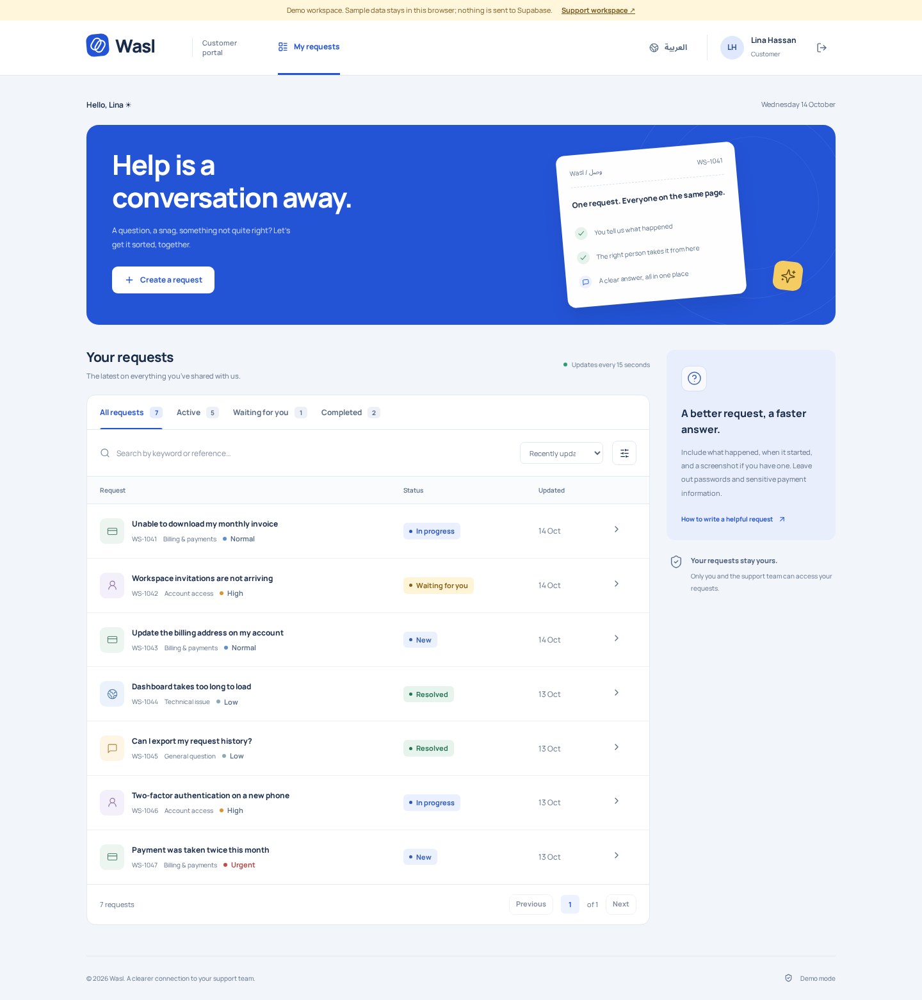
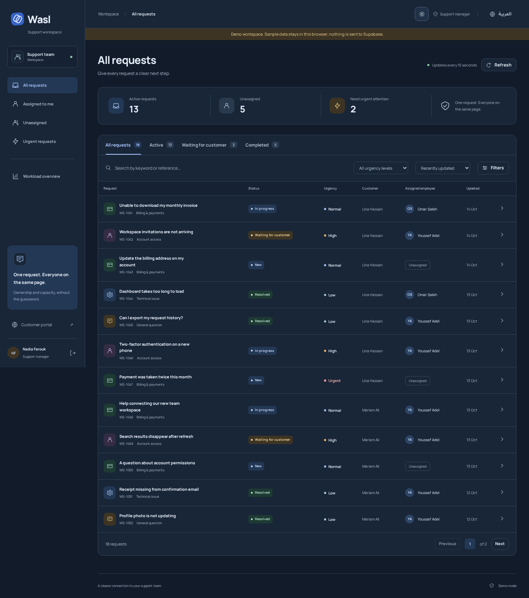

# Wasl | وصل

### Customer support, connected.

A bilingual customer support platform that connects customers, support agents, and managers through one shared request workflow. Two purpose-built applications use the same Supabase backend: a **React customer portal** and an **Angular support workspace**.

[](https://github.com/omar65978/wasl-support-platform-v2/actions/workflows/verify.yml)

[Customer portal](https://wasl-support-platform-v2.vercel.app/customer/) · [Support workspace](https://wasl-support-platform-v2.vercel.app/support/) · [Setup guide](docs/BACKEND.md) · [Architecture](docs/ARCHITECTURE.md)

## Overview

Wasl brings request ownership, urgency, progress, and communication into one place. Customers can ask for help and follow the conversation; support teams can claim work, collaborate privately, and provide a clear resolution.

- **Two connected applications:** React for customers, Angular for support employees.
- **Three distinct roles:** customer, agent, and manager, with server-enforced permissions.
- **One shared workflow:** create, assign, investigate, communicate, resolve, and reopen.
- **English and Arabic:** translated interfaces, RTL layouts, and responsive navigation.
- **Light and dark appearance:** persistent preferences, system-aware defaults, and cross-tab synchronization.

## Preview

### Customer portal — light mode



### Support workspace — dark mode



Screenshots use sample data. Additional [screenshots](docs/screenshots) include conversations, manager reporting, and Arabic mobile layouts.

## Try the applications

| Application       | Link                                                                   | Intended users      |
| ----------------- | ---------------------------------------------------------------------- | ------------------- |
| Customer portal   | [Open portal](https://wasl-support-platform-v2.vercel.app/customer/)   | Customers           |
| Support workspace | [Open workspace](https://wasl-support-platform-v2.vercel.app/support/) | Agents and managers |

**Demo access** uses browser-local sample data and is clearly labeled. It requires no account, does not write to Supabase, and does not support attachments. Use the two applications on the same origin and browser to explore the shared demo workflow.

**Signed-in access** uses Supabase Auth and the shared database. Sign in with a provisioned account to use real requests and protected attachments. Demo records are not automatically transferred to the connected workspace.

## Features

### For customers

- Register and sign in using email and password.
- Recover account access through a secure email link and a bilingual password-reset screen.
- Submit a request with a description, category, and urgency.
- Search and filter their own requests.
- Follow progress and exchange messages with the support team.
- Upload and download permitted attachments.
- Review the resolution and reopen a request when more help is needed.

### For support agents

- Find urgent, unassigned, or personally assigned work.
- Search, filter, sort, and paginate requests without loading the entire dataset.
- Claim an available request and take responsibility for it.
- Send customer-visible replies and separate internal notes.
- Update progress, adjust urgency, and resolve assigned requests.

### For support managers

- Review the complete request workload.
- Reassign requests to support employees.
- Access server-aggregated workload summaries.
- Manage requests beyond their personal assignments.

### Across both applications

- Shared user, role, and request models.
- Password recovery from either sign-in screen, with expired-link handling and password confirmation.
- Loading, empty, validation, success, and error states.
- Preserved message drafts when an update is rejected.
- Version checks that prevent stale updates from silently overwriting newer changes.
- Periodic refresh for current request information.
- Semantic controls, keyboard focus, reduced-motion support, and self-hosted fonts.

## Technology

| Area                 | Implementation                                                            |
| -------------------- | ------------------------------------------------------------------------- |
| Customer application | React 19, React Router, Vite                                              |
| Support application  | Angular 21, standalone components, guarded routes                         |
| Shared code          | TypeScript models, repository, Auth controller, translations, theme logic |
| Authentication       | Supabase Auth                                                             |
| Database             | PostgreSQL, row-level security, transactional RPCs                        |
| File storage         | Private Supabase Storage bucket                                           |
| Tests                | Vitest, PGlite, Playwright, axe-core                                      |
| Deployment           | Vercel static hosting for both applications                               |
| Automation           | GitHub Actions                                                            |

## Architecture

```text
React customer portal ──┐
                        ├── Shared TypeScript layer ── Supabase Auth
Angular support app ────┘                          ├── PostgreSQL + RLS + RPCs
                                                  └── Private Storage
```

Authentication state is managed by a shared controller. Each application renders the appropriate experience, while the database independently enforces access to requests, messages, actions, and files.

Frontend route guards improve navigation; they are not the security boundary. See [Architecture and security](docs/ARCHITECTURE.md) for implementation details and design decisions.

### Request lifecycle

```text
New → In progress ⇄ Waiting for customer → Resolved
          ↑                                    │
          └──────────── Reopen ────────────────┘
```

A customer reply to a waiting request returns it to investigation. Resolving requires an assigned employee and a written resolution. Resolved requests reject ordinary messages and uploads until reopened.

### Permission summary

| Capability                 | Customer              | Agent                      | Manager              |
| -------------------------- | --------------------- | -------------------------- | -------------------- |
| Read requests              | Own requests          | All requests               | All requests         |
| Create requests            | Yes                   | No                         | No                   |
| Claim unassigned work      | No                    | Yes                        | Yes                  |
| Reply and upload files     | Own active requests   | Assigned active requests   | Any active request   |
| Read internal notes        | No                    | Yes                        | Yes                  |
| Add internal notes         | No                    | Assigned active requests   | Any active request   |
| Update progress or resolve | No                    | Assigned requests          | Any assigned request |
| Reopen requests            | Own resolved requests | Assigned resolved requests | Any resolved request |
| Reassign responsibility    | No                    | No                         | Yes                  |
| View workload reports      | No                    | No                         | Yes                  |

An unassigned request must be claimed or assigned before replying through the support interface. Detailed lifecycle rules and ownership assumptions are documented in [ARCHITECTURE.md](docs/ARCHITECTURE.md).

## Quick start

### Requirements

- **Node.js 22 LTS recommended.** The current package configuration permits Node.js 20.19 or later; see the individual framework requirements when choosing another release.
- **npm 10 or later.**
- Git to clone the repository.
- A configured Supabase project for signed-in workflows; no backend setup is needed for the browser-local demo.

### Install and run

```bash
git clone https://github.com/omar65978/wasl-support-platform-v2.git
cd wasl-support-platform
npm ci
npm run build
npm run preview
```

| Application       | Local URL                         |
| ----------------- | --------------------------------- |
| Customer portal   | `http://localhost:4173/customer/` |
| Support workspace | `http://localhost:4173/support/`  |

Select a demo role to explore the product, or sign in with an existing account to use the configured backend.

### Development

```bash
npm run dev
```

- React: `http://localhost:5173/customer/`
- Angular: `http://localhost:4200/support/`

Both applications use the same configured Supabase project. Browser storage is origin-scoped: development ports have separate sessions and separate demo data. Use the combined preview on port 4173 for a cross-application demo. Use separate browser profiles when testing multiple signed-in users simultaneously.

## Configuration and backend setup

The repository includes public connection defaults for the configured Wasl instance. It does not include administrative credentials or account passwords.

For your own instance, copy `.env.example` to `.env`, then replace both values with your own project configuration:

```env
SUPABASE_URL=https://YOUR_PROJECT_REF.supabase.co
SUPABASE_PUBLISHABLE_KEY=sb_publishable_YOUR_PUBLIC_KEY
```

Then run:

```bash
npm run config
npm run build
```

Root build and development commands also refresh public configuration automatically. Environment variables take precedence over local files. Only hosted HTTPS Supabase URLs and publishable keys are accepted by the configuration script.

**Never put a database password, an `sb_secret_` key, or a service-role key in browser configuration.** A publishable key is public; data protection depends on correctly enforced database and Storage permissions.

### Initialize a new database

For a fresh, unconfigured project, follow [BACKEND.md](docs/BACKEND.md). It covers:

- Applying the initial schema and policies through SQL Editor or the Supabase CLI.
- Configuring authentication URLs and email delivery.
- Creating test accounts and assigning staff roles.
- Setting up and verifying private attachments.

**Do not rerun `supabase/setup.sql` on an already initialized database.** It is an initial migration, not a reset script. Existing instances should receive deliberate, versioned migrations rather than repeated initialization.

Staff accounts are administrator-managed. Public registration always creates a customer; user-editable metadata cannot grant an agent or manager role.

## Password recovery

Both sign-in screens include **Forgot password?**. The email flow opens a localized reset screen, validates matching passwords, handles unusable links, and returns the user to sign-in. Recovery does not require a profile row, but application access still does.

Before using it on a deployed instance, configure the exact recovery redirect URLs and verify the email template. See [Password recovery setup and verification](docs/PASSWORD-RECOVERY.md). No database migration is required.

## Attachments and data protection

- Accepted types: **PDF, PNG, and JPEG**.
- Maximum size: **5 MiB per file**.
- Maximum attachments: **50 per request**.
- Files are uploaded to randomized, reserved paths in a private bucket.
- Upload finalization rechecks ownership, request state, and stored metadata.
- Internal notes and internal attachment records are excluded from customer queries.
- Downloads use authenticated Storage access, not public file URLs.

Client-side file signature checks complement server-side MIME and size restrictions; they are not server-side malware scanning. See the [operational limits](#operational-limits) before a production rollout.

## Testing

### Database and shared logic

```bash
npm test
```

The database suite executes the delivered SQL migration in PGlite using minimal Auth and Storage fixtures. Shared tests cover validation, permission helpers, translations, configuration, and theme behavior.

### Browser workflows

```bash
npm run build
npx playwright install --with-deps chromium
npm run test:e2e
```

Playwright covers the cross-application request workflow, role guards, private notes, filtering and pagination, conflict recovery, Arabic/mobile layouts, keyboard interactions, theme persistence, and representative automated accessibility checks.

### Quality checks

```bash
npm run format:check
npm run verify
npm audit
```

The latest recorded verification includes **52 SQL/unit/configuration tests and 29 browser tests**. Recovery browser tests use mocked Auth responses; hosted email delivery and live password changes require separate owner verification. The workflow badge reports the latest GitHub Actions result. These counts are not a claim of complete coverage or accessibility certification.

### Hosted integration

Copy `.env.live.example` to `.env.live`, supply the configured test project's URL, publishable key, and test-account password, then run:

```bash
npm run test:live
```

Use a dedicated test project and the documented test accounts. This suite creates a verification request and two small files, checks real API and Storage permissions, and retains the evidence. Keep `.env.live` private.

**Local SQL tests and demo browser tests do not establish that a hosted Supabase deployment is configured correctly.** Authenticated hosted verification is a separate step. See [VERIFICATION.md](docs/VERIFICATION.md) for the recorded scope and remaining integration checks.

## Deploy to Vercel

Import the **repository root** as one Vercel project. Do not select an individual application directory.

| Setting          | Value                  |
| ---------------- | ---------------------- |
| Framework Preset | `Other`                |
| Root Directory   | `./`                   |
| Install Command  | `npm ci`               |
| Build Command    | `npm run build:vercel` |
| Output Directory | `site`                 |

Set these environment variables for Production and Preview:

```text
SUPABASE_URL
SUPABASE_PUBLISHABLE_KEY
```

Use your complete project URL, such as `https://YOUR_PROJECT_REF.supabase.co`, **not** the generic `https://supabase.co` address. Cloud builds require both variables; changing them requires a redeployment.

After deployment:

1. Set Supabase **Site URL** to the deployed customer portal URL.
2. Add the exact `/customer/` and `/support/` URLs to **Redirect URLs**, plus both URLs with `?auth=recovery` for password recovery. See [Password recovery](docs/PASSWORD-RECOVERY.md) for the exact production values and email-template requirements.
3. Verify registration confirmation, sign-in, requests, and protected attachments.

Both applications share the deployed origin. The root redirects to `/customer/`, and hash-based application routes support direct links and refreshes without application-specific server rewrites.

See [VERCEL.md](docs/VERCEL.md) for the complete guide and troubleshooting. [DEPLOYMENT.md](docs/DEPLOYMENT.md) covers alternative Node, Docker, and static hosting options.

## Repository structure

```text
apps/
  customer/                 React customer portal
  support/                  Angular support workspace
packages/shared/src/
  auth.ts                   Authentication state and account operations
  api.ts                    Shared data access and attachment workflow
  types.ts                  Roles, request models, and validation
  i18n.ts                   English and Arabic interface copy
  theme.ts                  Persistent appearance preferences
  tokens.css                Light and dark semantic color palettes
  styles.css                Shared interface primitives
  demo.ts                   Explicit browser-local demo environment
supabase/
  setup.sql                 Initial SQL Editor setup
  migrations/               Versioned database schema
scripts/                    Build, configuration, account, and verification tools
tests/                      SQL, unit, and browser suites
docs/                       Architecture, setup, deployment, and screenshots
.github/workflows/          Continuous verification
vercel.json                 Combined static deployment configuration
```

## Documentation

| Guide                                            | Purpose                                                        |
| ------------------------------------------------ | -------------------------------------------------------------- |
| [Architecture](docs/ARCHITECTURE.md)             | Auth, permissions, data access, concurrency, and scaling       |
| [Backend setup](docs/BACKEND.md)                 | Database initialization, test accounts, and Storage            |
| [Workflow walkthrough](docs/DEMO.md)             | Customer, agent, and manager demonstration                     |
| [Verification record](docs/VERIFICATION.md)      | Executed checks and verification boundaries                    |
| [Vercel deployment](docs/VERCEL.md)              | Build settings, environment variables, and authentication URLs |
| [Design decisions](docs/DESIGN.md)               | Visual direction, typography, and appearance modes             |
| [Requirement traceability](docs/REQUIREMENTS.md) | Requirements mapped to implementation and tests                |
| [Arabic guide](docs/HANDOFF-AR.md)               | Setup and deployment instructions in Arabic                    |

## Operational limits

- Visible pages refresh every **15 seconds**; updates are polled, not pushed in realtime.
- Request browsing uses indexed search and offset pagination. Very large datasets may require keyset pagination and revised count strategies.
- Conversations initially load 40 messages; the current expanded-window implementation is constrained by the hosted PostgREST row cap, documented as 1,000 messages. Activity displays the latest 40 events.
- The staff selector supports up to 1,000 employees.
- Interrupted uploads can leave unfinished reservations or objects requiring administrator cleanup.
- Production file intake may require server-side content inspection, quarantine, and malware scanning.
- Request-update email notifications, offline writes, saved filters, and satisfaction ratings are not implemented. Authentication email delivery depends on the configured mail service.
- SMTP, backups, abuse controls, retention, monitoring, and deployment configuration remain operational responsibilities.

## License and attribution

No project-wide open-source license has been assigned in this repository. Public visibility alone does not grant unrestricted reuse rights.

Manrope and Noto Sans Arabic are distributed with their respective licenses under [`assets/fonts/`](assets/fonts). Third-party dependencies retain their own licenses.
